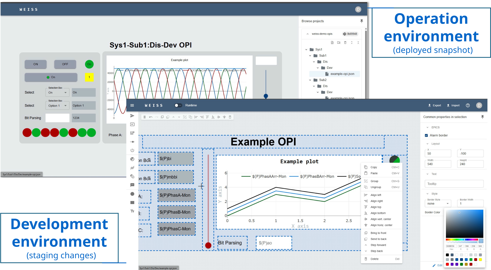

# WEISS – Web EPICS Interface & Synoptic Studio

WEISS is a no-code, drag-and-drop system for building web-based EPICS operation interfaces. It
provides a responsive editor, live PV communication (read and write), git-based version control and
a lightweight deployment model.

|                             Live demo                              |                           Documentation                            |                               Planned features                                |
| :----------------------------------------------------------------: | :----------------------------------------------------------------: | :---------------------------------------------------------------------------: |
| [https://demo.weiss-controls.org](https://demo.weiss-controls.org) | [https://docs.weiss-controls.org](https://docs.weiss-controls.org) | [GitHub Project Dashboard](https://github.com/orgs/weiss-controls/projects/1) |

---

## Licensing Terms

Copyright (C) 2026 WEISS Contributors

This program is free software: you can redistribute it and/or modify it under the terms of the GNU
General Public License as published by the Free Software Foundation, either version 3 of the
License, or (at your option) any later version.

This program is distributed in the hope that it will be useful, but WITHOUT ANY WARRANTY; without
even the implied warranty of MERCHANTABILITY or FITNESS FOR A PARTICULAR PURPOSE. See the GNU
General Public License for more details.

You should have received a copy of the GNU General Public License along with this program. If not,
see <https://www.gnu.org/licenses/>.
